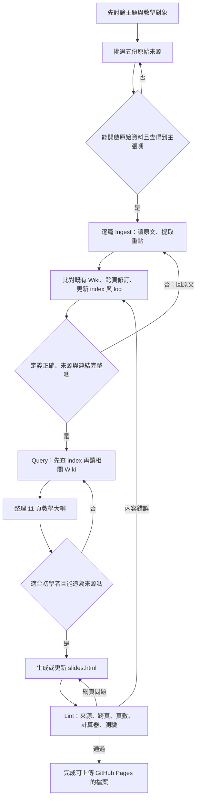

# Workflow / Graph：5 次 Ingest → Query → Lint → HTML 教學簡報

## 一、先討論，再產生

選擇「股票回購真的會犧牲企業投資嗎？」作為主題，是因為 EPS、回購與因果很容易被誤解，適合拆成由淺入深的教學。依照前面與使用者的討論，目標是讓沒有金融背景的學生能學會：**EPS 提高不代表總獲利提高；相關不代表因果；Fuzzy RDD 在特定假設下辨識局部效果**。

## 二、實際使用的 Graph

## 三、五次 Ingest 是如何做的？

五個原始網址已於 2026-11-22 在 ChatGPT 的網頁查閱工具逐篇開啟。每次閱讀後，不只是寫摘要，而是對照之前的 Wiki 做了**增量修改**。

| 次數 | 原始資料 | 實際更新的 Wiki | 核對重點 |
| --- | --- | --- | --- |
| S1 | IFRS IAS 33 | `01-eps` | EPS 分母是期間加權平均流通股數 |
| S2 | SEC 2002 proposed rule | `02-buyback`、`01-eps` | 回購有不同用途；提案不是現行法 |
| S3 | Almeida 等人作者文章 | `03-research`、`01-eps`、`02-buyback` | 門檻研究與後續投資結果，不能過度推論 |
| S4 | The Effect Ch. 8 | `04-endogeneity`、`03-research` | 共同原因造成替代因果路徑 |
| S5 | The Mixtape Ch. 6 | `05-rdd`、`03-research`、`04-endogeneity` | Fuzzy RDD 是處理機率跳躍 |

**證據在哪？** 每次原文核對摘要在 `raw/verified_notes/S1–S5-verified.md`；每個 wiki 差異在 `audit/ingest_diffs/S*-*.diff`；每次逐篇操作在 `wiki/log.md`。這些是在 ChatGPT 裡的資料整合紀錄，不是使用者本機 Coding Agent 截圖。

## 四、Query 與 HTML 生成

Query 問題：「如何讓沒學過金融的人在 11 頁內理解股票回購、EPS 與因果研究？」先讀 `wiki/index.md`，再查五篇核心頁，整理從「回購與 EPS」到「因果與 Fuzzy RDD」的順序。每頁對應哪份 Wiki 和 S1–S5，詳見 `audit/query_trace.md`。最後產出 `slides.html`，附互動 EPS 計算器、翻頁與兩道小測驗。

## 五、Lint、失敗回圈與檢查前移

**會反覆的地方**：每次 Ingest 後重新核對來源；Query 缺證據時回 Wiki；HTML 測試不過就回到建置；若是內容錯誤則先改 Wiki 再改 HTML。

**實際出錯**：早期簡報建置漏把封面算成一頁；後來增加 `index.md`、`log.md` 時，測試程式誤把管理檔也算進五篇知識頁。這兩個問題都出在組裝／驗證階段。

**檢查前移**：把「有幾篇知識頁」的檢查移到建立 Wiki 檔案結構時；把「EPS 用加權平均股數、SEC 是 2002 年提案、RDD 只能作局部解讀」移到 Ingest 和 Query 階段檢查；把頁數檢查移到產出 HTML 時就執行。

**為什麼修改 Graph**：如果等網站做好才發現知識有誤，會連帶重做多張投影片。越早檢查越容易找到根本原因，也可避免檢查規則自己出錯。

## 六、檢查紀錄與界線

原 HTML 項目已做 17 項自動檢查，初版通過 17/17。新版另有 `audit/wiki_lint_results.json`，核對 wiki 連結與 ingest 紀錄。兩者不等於學術研究的全面事實查核。實際上網發布、學號和姓名仍由使用者補上；本次沒有在第三方 hosted 平台或使用者本機 Codex／Claude Code 操作。
